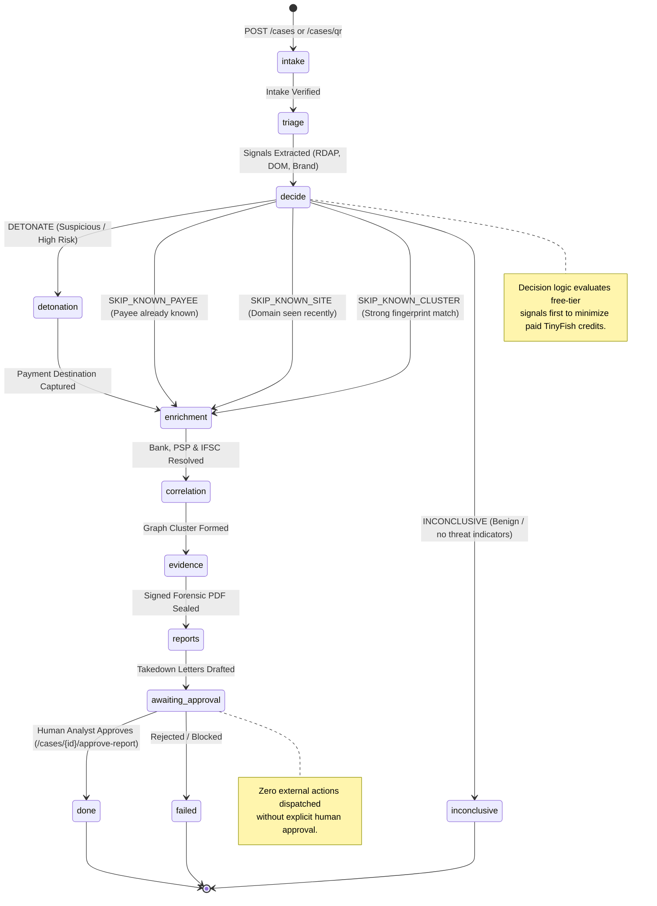
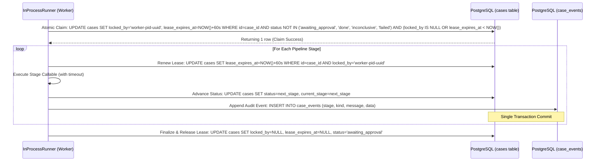

# STING Pipeline Architecture & State Machine

**Module:** Autonomous Investigation Orchestration Engine  
**Authors:** Team void main  

---

## 1. Overview & Core Philosophy

STING is structured as a **linear stage pipeline with conditional branch points**. It intentionally avoids distributed actor frameworks (e.g. Celery, Redis, LangGraph, arq) in the core build to eliminate distributed race conditions, minimize external infrastructure, and guarantee that pipeline state survives process crashes without state desynchronization.

### Core Invariant: One Case = One Runner Invocation
Each case is claimed and executed by a single runner task from intake through all sequential stages. Stages never enqueue other stages asynchronously; state is persistently advanced in PostgreSQL within atomic transactions.

---

## 2. Mermaid State Transition Diagram

---

## 3. Worker Lease Locking Protocol

To prevent two concurrent workers, a resumed worker, or a retrying process from executing the same case simultaneously, STING uses an **atomic database lease lock**:

---

## 4. Restart Recovery

When the STING backend restarts after a reboot or container crash:
1. `resume_incomplete_cases()` is invoked during application startup (`lifespan`).
2. It queries for all cases where `status NOT IN ('awaiting_approval', 'done', 'inconclusive', 'failed')` and `(locked_by IS NULL OR lease_expires_at < NOW())`.
3. Interrupted cases are picked up exactly at their current recorded stage.
4. All stages are strictly idempotent: re-executing a stage replaces temporary values and continues seamlessly.
